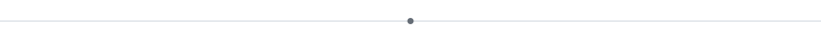

**独立开发者，做 iOS、鸿蒙和 Web 全栈。来自浙江嘉兴。** 
**Indie developer building across iOS, HarmonyOS and the web. Based in Jiaxing, China.**

 

<b>鸿蒙电脑上的桌面清扫机器人。</b>它在真实桌面上巡扫，可以按类型整理文件、移入回收站或永久删除，每一步都先让你确认。 
<b>A desktop-sweeping robot for HarmonyOS PCs.</b> It patrols your real desktop, sorts, recycles or deletes files, and asks before every step.

<b>用 AI 改图片里的文字。</b>识别原图上的字，换成你要的内容，文字区域以外的像素不动。Web、iOS、鸿蒙三端。 
<b>Edit the text inside any image with AI.</b> It reads the text, swaps in what you want, and leaves every pixel outside the text region untouched.

<b>读懂整个项目的 Agent skill。</b>读源码和文档，生成一份可交互的项目大脑地图 HTML，包含能力树、业务流程、DDD 架构和 Mermaid 图，每条结论都标明证据。 
<b>An agent skill that maps an entire project.</b> It reads your code and docs and builds an interactive, evidence-backed brain map with capability trees, flows, DDD and Mermaid diagrams.

